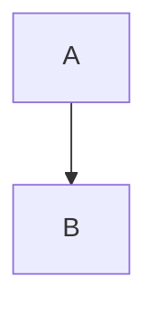

# Код

```rust
fn main() {
    println!("привет");
}
```

````md
Внутри есть ``` тройные кавычки
````

    отступный блок кода
    вторая строка



```dataview
TABLE file.name FROM "Проекты"
```

Строка с `код ` с пробелом и ``двойными `кавычками` `` внутри.
